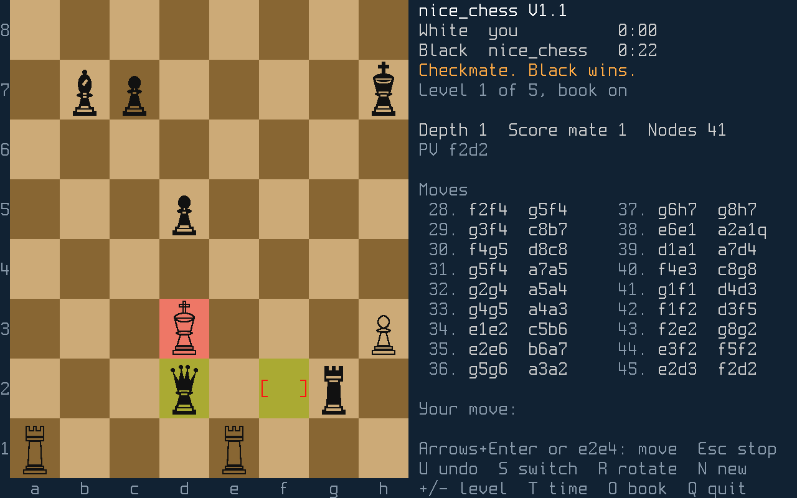

# nice_chess

A simple chess engine for the NICE system

It runs on the MEGA65 with the board shown on
the screen, and moves entered by the keyboard. It is a port of the
[mchess2](https://github.com/MJoergen/mchess2) engine;
[doc/HISTORY.md](https://github.com/MJoergen/nice_chess/blob/main/doc/HISTORY.md)
tells how it was done.

## Download

Each [release](https://github.com/MJoergen/nice_chess/releases) has
`nice_chess-TAG.tar.gz`, where TAG is the release, such as `V1.0`, and
`SHA256SUMS`. [RELEASE_NOTES.md](RELEASE_NOTES.md) says what changed
in each, and what it needs. The archive's directory has:

- `mega65/`: both front ends for the MEGA65:
  `CHESS.BIN`, the windowed front end, and `CHESST.BIN`, the text
  front end. They have 8.3 names, so the monitor loads them from the SD
  card.
- `niceemu/`: both front ends for niceemu (In niceemu, below).
- `linux-x86_64/nice_chess`: the text front end on the host, linked
  statically: the same commands at a terminal, and a UCI engine for a
  chess GUI.

The front ends show their version: the title of the window, the
banner of the text front end, and its UCI `id name`.

## On the MEGA65

`CHESS.BIN` runs on the MEGA65 under the monitor of
[NiceMonMEGA65](https://github.com/MJoergen/NiceMonMEGA65), V2.0 or
later. The monitor loads it from a FAT32 SD card, so the board needs
no host.

On a PC, make the folder `NICE` in the root of the card and copy
`CHESS.BIN` from the release into it. Put the card in the MEGA65 and
type at the monitor's prompt:

    load CHESS.BIN
    r

## Playing

The board is on the 80×25 screen. Move with the cursor keys and
RETURN, or type a move such as `e2e4` and RETURN. A promotion by the
cursor keys is to a queen; for another piece, type the move, such as
`e7e8n`. Space is RETURN, INST/DEL erases a typed move, and ESC drops
a piece picked up or a typed move.

The other keys are on the screen:

- U: undo a move.
- S: switch sides.
- R: rotate the board.
- N: a new game.
- \+ and −: the level, or under a time control, the strength.
- T: the next time control, and a new game.
- O: the opening book on or off.
- P: pondering on or off.
- ESC: make the engine move now.
- Q: clear the screen and return to the monitor.

The game starts with no time control, at level 3. There are 5 levels;
a level sets the time the engine takes for a move, and below level 5,
noise in its evaluation, as the strengths below do:

| Level | Time a move | Noise    | Elo (CCRL 40/4) |
|------:|------------:|---------:|----------------:|
| 1     | 0.6 s       | ±800 cp  | 790             |
| 2     | 1.7 s       | ±600 cp  | 1190            |
| 3     | 5 s         | ±320 cp  | 1630            |
| 4     | 15 s        | ±170 cp  | 1960            |
| 5     | 45 s        |          | 2240            |

The ratings are those `make rate` measured on 2026-11-12
([LOG.md](https://github.com/MJoergen/nice_chess/blob/main/LOG.md)),
each within about 40, and level 1 within about 100. Level 1 is the
least sure: it is far below the weakest of Stockfish's levels.

The book is on at first. The engine plays a move from the book at
once, at any level, and picks it at random by the moves' weights, so
the openings differ from game to game.

Each side has a clock. With no time control, it counts up the real
time the side has taken, and N sets both to 0.

T steps through the time controls, and starts a new game with each:

| Time control    | Base       | Increment a move |
|-----------------|-----------:|-----------------:|
| none            |            |                  |
| Blitz 3+2       | 3 minutes  | 2 s              |
| Rapid 15+10     | 15 minutes | 10 s             |
| Classical 90+30 | 90 minutes | 30 s             |

Under a time control, each clock counts down from the base, and gains
the increment after each of its side's moves. A side whose clock
reaches 0 loses, whatever the material on the board. The engine takes
a share of the time on its clock: a thirtieth of it, and three
quarters of the increment, but never more than half of it. U takes
back moves, not time. N starts the game again, with the same time
control.

Under a time control, + and − set the engine's strength, from 1 to 5,
the full strength and the default. Below 5, the engine adds noise to
its evaluation of each position, so it misjudges some, and it takes
only a share of its time, so it sees fewer tactics. It then moves
early, and keeps the rest of its time:

| Strength | Noise    | Share of the time | Elo (CCRL 40/4) |
|---------:|---------:|------------------:|----------------:|
| 5        |          | all               | 1850            |
| 4        | ±90 cp   | 1/1.5             | 1730            |
| 3        | ±160 cp  | 1/2.2             | 1580            |
| 2        | ±360 cp  | 1/3               | 1280            |
| 1        | ±500 cp  | 1/3.8             | 1140            |

The ratings are those `make rate` measured at Blitz's time on the
board, on 2026-11-10 (LOG.md).

The noise of a position is the same within a game, and differs from
game to game.

The engine ponders: while you think, it searches the position after
the move it expects of you, the second move of its principal
variation. If you play that move, its search goes on, with the
engine's time counted from your move, so it sees deeper. If you play
another, it starts again. Pondering is on at first, at every level and
strength, and P turns it off. The ratings above were measured without
it; on the host, pondering was worth about 60 Elo at 10+0.1 (LOG.md).

## The text front end

`CHESST.BIN` is the text front end. It loads from the SD card the same
way as `CHESS.BIN`, but its terminal is the debug UART, or
`nc IP 4510` over Ethernet, so it needs a host.

Type `help` for the commands. Moves are in coordinate notation, such
as `e2e4` or `e7e8q`, and `go` makes the engine move: 5 seconds on the
board. `go depth 4` or `go nodes 20000` are quicker. `book on` makes
`go` play from the opening book, where the position is in it, and
`book` lists its moves.

## In niceemu

The front ends for niceemu run in the niceemu of nice_cpu's
[V2.0 release](https://github.com/MJoergen/nice_cpu/releases/tag/V2.0):
`niceemu-V2.0-x86_64-linux.tar.gz` runs the text front end, and the
window build, `niceemu-window-V2.0-x86_64-linux.tar.gz`, runs both.
From the archive:

    niceemu --step-time niceemu/chess_text.bin
    niceemu --window --step-time niceemu/chess_screen.bin

In the window, the keys are those of the MEGA65: the arrows, Enter,
and Backspace for INST/DEL.

`--step-time` makes niceemu's clock count steps, one microsecond each,
rather than the host's time; the window runs as fast as the host can.
`go` then takes 300 million steps, about 7 seconds in the emulator,
and the clocks count steps at 54 million a second, the board's rate,
so they show the time the board would take. In niceemu the book's
seed is fixed, so its choice is the same every run.

`--step-time` is optional for playing. Without it, the engine takes
niceemu for a board: `go` takes 5 seconds of the host's time, the
clocks show the host's time, and the moves depend on the host's speed.
The tests and the tools run niceemu with it, so that the runs are
deterministic.

## On the host

`linux-x86_64/nice_chess` has the same commands as the text front end
at a terminal; there `go` takes 1 second. After `uci` it speaks UCI,
so a chess GUI can play it. Its option `OwnBook` turns the book on; it
is off at first. Its option `Strength`, 1 to 5, is the strength of the
windowed front end; it is 5 at first. Its option `Noise`, 0 to 1000,
is the noise of a level in centipawns; it is 0 at first, and counts
only at strength 5. It ponders: `go ponder` thinks on
the opponent's time, on the reply that its `bestmove ... ponder M`
named.

## Building

From a checkout, `make deps all` fetches nice_cpu and niceemu into
`deps/` and builds the front ends into `build/nice/` (niceemu),
`build/mega65/` (the MEGA65), and the host.
[CONTRIBUTING.md](https://github.com/MJoergen/nice_chess/blob/main/CONTRIBUTING.md)
lists what that needs, and the tests:

    deps/niceemu-V2.0-x86_64-linux/niceemu --step-time build/nice/chess_text.bin

`build/mega65/chess_screen.bin` is `CHESS.BIN`; renamed to an 8.3
name, it loads from the SD card. The monitor gives a program 92K words
of RAM.

## The board from a host

From a host, the builds are loaded over the board's Ethernet port or
its debug UART with NiceMonMEGA65's tools, from a checkout of it
(`NICEMON=DIR`, `../NiceMonMEGA65` by default), with `ETH=IP` or
`PORT=/dev/ttyUSBn`:

    make board-screen ETH=192.168.1.65   # the windowed front end, on the board's screen and keyboard
    make board-text ETH=192.168.1.65     # the text front end; then nc 192.168.1.65 4510 is its terminal
    make board-test ETH=192.168.1.65     # the tests of both front ends, on the board
    make board-game ETH=192.168.1.65     # a full game by the keys, through the link (a few minutes)
    make board-match ETH=192.168.1.65    # two UCI games against the host build (about 15 minutes)
    make board-stockfish ETH=192.168.1.65  # a game on the board's screen against Stockfish

`make board-stockfish` plays the windowed front end on the board
against Stockfish (`STOCKFISH`) at UCI_Elo `ELO` (1800) and `MOVETIME` ms
(1000) a move, by its keys, through `tools/screen_game.py`; the board's screen
shows the game as it is played. Stockfish is white, or black with
`BLACK=1`. The host prints each move, with the score of a second
Stockfish, at its full strength, from white's side.

`tools/board_uci.py --eth IP build/mega65/chess_text.bin` loads the
text front end into the board and is then a UCI engine on the host, so
cutechess-cli, a chess GUI, or lichess-bot can play the board against
other engines. Its docstring has a cutechess-cli example; there,
`dir=.` keeps the path of the .bin relative to the current directory.
The board's clock is real, and one board plays one game at a time.

`tools/lichess_engine.sh` runs `board_uci.py` as lichess-bot runs an
engine: one command, with the link in `BOARD_ETH` or `BOARD_PORT`
(/dev/ttyUSB3 by default). `tools/lichess-bot.yml` is a template of
lichess-bot's `config.yml` for it; the API token goes in
`LICHESS_BOT_TOKEN`, not in a file in git.

## Matches and ratings

`tools/match.py` plays two UCI engines against each other, and can run
the NICE build in niceemu, or on the board, as one of them.
`make rate` rates each of the 5 levels, and each strength, at the
board's speed against Stockfish's UCI_Elo levels, with cutechess-cli
and Ordo (CONTRIBUTING.md); the tables in Playing are its results.

## License

MIT, in [LICENSE](LICENSE).
